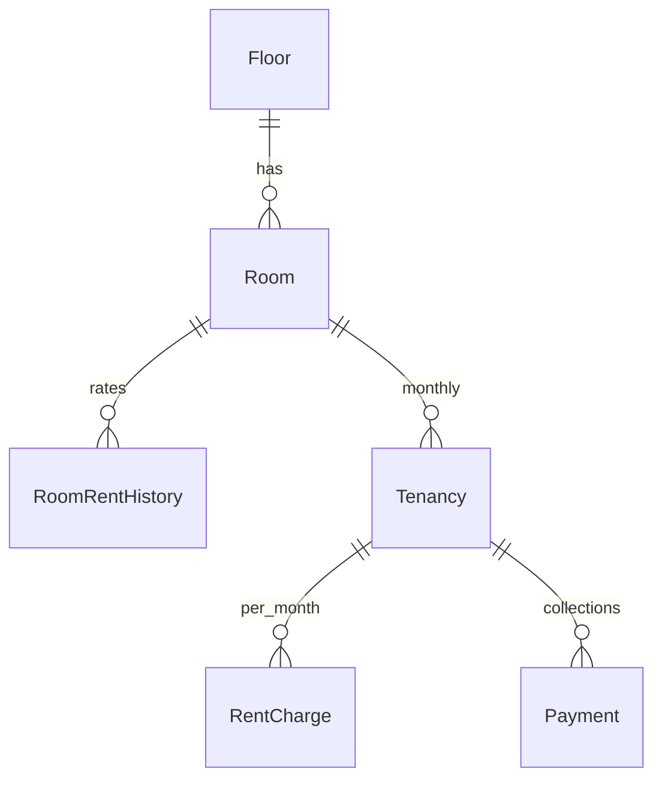
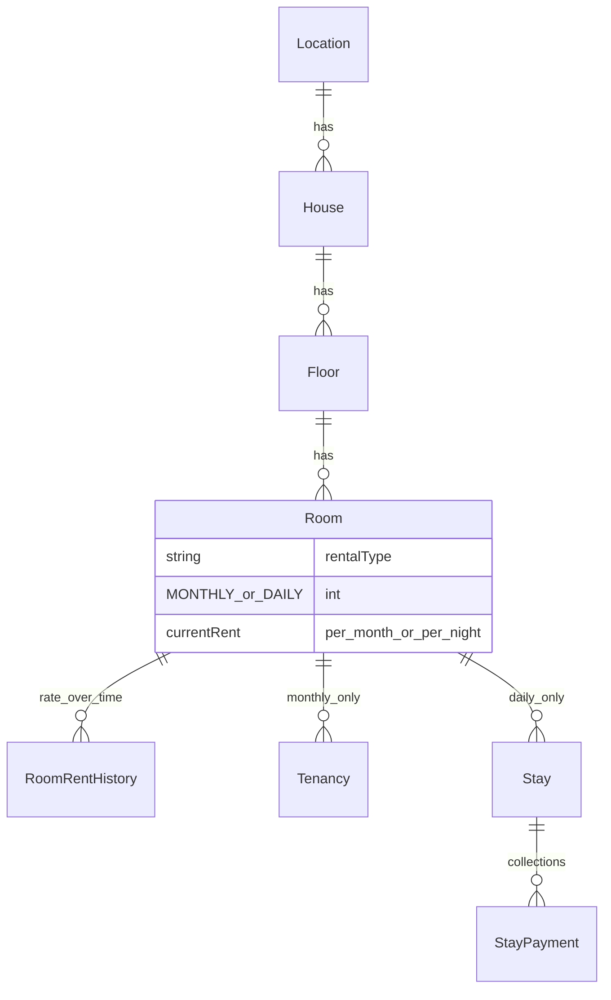
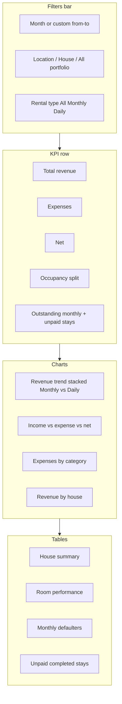

# Multi-location, mixed rental types, and stay billing

## Current baseline

Today the app assumes **one property** ([`getSettings()`](src/server/services/common.ts) `propertyName` / `propertyAddress`) and **monthly-only** billing:

- Hierarchy: [`Floor`](src/server/entities/core.ts) → [`Room`](src/server/entities/core.ts) (room `number` is **globally** unique).
- Rates: `currentRent` + [`room_rent_history`](src/server/entities/core.ts) with [`rentForMonth`](src/server/services/billing-core.ts) / [`ensureCharges`](src/server/services/billing.ts).
- UI: [`rooms/page.tsx`](src/app/(admin)/rooms/page.tsx), dashboard tiles via [`roomTiles`](src/server/services/queries.ts), tenant check-in in [`tenants.ts`](src/server/services/tenants.ts).

Your choices: **stay ledger** for daily (check-in/out, nights × rate) and **Location → House → Floor → Room**.

---

## Target model

**Rate semantics (dynamic costs):** Keep one history table, extended so each row stores **`rentalType` + `rent`** + `effectiveFrom`. `Room.rentalType` and `Room.currentRent` are the latest values. [`changeRent`](src/server/services/rooms.ts) applies to the room’s **current** type; [`changeRentalType`](src/server/services/rooms.ts) (new) switches type when the room is vacant and inserts a history row for the new type/rate from an effective date (default today).

**Changing rental type (MONTHLY ↔ DAILY):**

- Allowed **only when the room is vacant**: no active `Tenancy`, no active `Stay`, and `status !== 'MAINTENANCE'` (or allow from maintenance after clearing maintenance — same as today).
- UI on [`rooms/page.tsx`](src/app/(admin)/rooms/page.tsx): “Rental type” dropdown on edit; when changed, prompt for **new rate** (₹/month or ₹/night) and optional **effective from** (default today).
- Server: `changeRentalType(actor, roomId, { rentalType, rent, effectiveFrom })` — inserts `room_rent_history` with the new type; updates `rooms.rentalType` + `currentRent` if effective date is today or past.
- **Historical data stays intact:** ended tenancies / completed stays and their charges/payments are not deleted. Future billing uses the new type only.
- **Do not reinterpret old history rows:** pre-change rows keep their stored `rentalType` (migration backfills `MONTHLY` on all existing history). A row with `rent: 600` and `MONTHLY` is never read as ₹600/night after a switch.

**Occupancy rules:**

| Room type | Occupied when | Billing |
|-----------|---------------|---------|
| MONTHLY | Active `Tenancy` | Existing `rent_charges` + payments (unchanged) |
| DAILY | Active `Stay` (`checkOut` null or today &lt; checkOut) | Stay total + `stay_payments` |

Enforce at check-in: reject monthly tenancy on `DAILY` rooms; reject overlapping stays on the same room; block stay if room is `MAINTENANCE`.

---

## Phase 1 — Schema and data migration

**New entities** in [`src/server/entities/core.ts`](src/server/entities/core.ts):

- `Location`: `id`, `name`, optional `notes`
- `House`: `id`, `locationId`, `name`, `address` (optional), `active`

**Alter existing:**

- `Floor`: add `houseId` (FK RESTRICT); replace global unique `number` with **unique (`houseId`, `number`)**
- `Room`: add `rentalType` (`MONTHLY` \| `DAILY`, default `MONTHLY`); replace global unique `number` with **unique per house** — e.g. unique (`houseId`, `number`) where `houseId` is denormalized on `Room` *or* enforced via join in app + partial unique index on `(floorId, number)` if floor is always scoped to one house
- `Stay`: `roomId`, `guestName`, `phone?`, `checkIn`, `checkOut?`, `dailyRate` (snapshot at check-in), `status`, `notes?`
- `StayPayment`: `stayId`, `amount`, `paidOn`, `method`, `referenceNo?`, `note?` (mirror [`Payment`](src/server/entities/core.ts) fields; no allocations needed if one charge per stay)
- `RoomRentHistory`: add `rentalType` (`MONTHLY` \| `DAILY`) on each row; backfill `MONTHLY` for existing rows

**Migration script** (new TypeORM migration alongside [`1791783135461-Init.ts`](src/server/migrations/1791783135461-Init.ts)):

1. Create `locations`, `houses`, `stays`, `stay_payments`.
2. Insert one `Location` + one `House` from current [`settings`](src/server/services/common.ts) (`propertyName`, `propertyAddress`).
3. Set all existing `floors.houseId` to that house.
4. Add columns/constraints; backfill `rooms.rentalType = 'MONTHLY'`.
5. Drop old global unique on `rooms.number` / `floors.number` after backfill.

**Settings:** Keep global billing knobs (`dueDay`, `prorate`) in settings; treat `propertyName` as **organization label** in the sidebar until/unless you add per-house branding on receipts later.

---

## Phase 2 — Services, queries, and guardrails

**New modules:**

- [`src/server/services/properties.ts`](src/server/services/properties.ts) — CRUD for locations/houses (admin-only, audited like [`rooms.ts`](src/server/services/rooms.ts)).
- [`src/server/services/stays.ts`](src/server/services/stays.ts) — `checkInStay`, `checkOutStay`, `recordStayPayment`, cancel stay; update `Room.status`.
- Extend [`billing-core.ts`](src/server/services/billing-core.ts) with pure helpers, e.g. `nightsBetween(checkIn, checkOut)` (checkout date = last billed night per your convention — document as **nights = days between check-in and check-out**, exclusive of checkout day unless you prefer hotel “night count”; pick one and test it) and `stayAmountDue(dailyRate, nights)`.

**Touch existing:**

- [`tenants.ts`](src/server/services/tenants.ts) `startTenancy`: require `room.rentalType === 'MONTHLY'`; ensure no active stay on room.
- [`billing.ts`](src/server/services/billing.ts) `ensureCharges`: only tenancies whose room is monthly (join or filter by room type).
- [`queries.ts`](src/server/services/queries.ts): join `houses` / `locations` on room listings; add `houseId?` / `locationId?` filters to KPIs, tiles, rent list, expenses.
- [`vacantRooms`](src/server/services/queries.ts): monthly vacancies exclude daily rooms (or separate `vacantDailyRooms` for stay check-in).

**Scope selector:** Persist **active house** in an httpOnly cookie (set via server action from layout), default = first house or migrated default. All list/dashboard queries filter by `houseId` when set; optional “All houses” for admin reports only (phase 2b if needed).

---

## Phase 3 — Admin UI

| Area | Change |
|------|--------|
| New **Properties** page (admin) | Manage locations → houses ([`docs/configuration.md`](docs/configuration.md) append section) |
| [`rooms/page.tsx`](src/app/(admin)/rooms/page.tsx) | Scope by selected house; add **Rental type** + label “₹/month” vs “₹/night”; rent history modal unchanged |
| New **Stays** page (or `/stays`) | List active/completed stays; check-in guest to vacant **daily** room; check-out sets date and final due; record payment |
| [`dashboard/page.tsx`](src/app/(admin)/dashboard/page.tsx) | Monthly tiles: only `MONTHLY` rooms; secondary strip or filter for daily rooms (guest name + stay balance) |
| [`tenants/...`](src/app/(admin)/tenants/[id]/page.tsx) | Room picker shows monthly rooms only; display house/location in room label |
| [`layout.tsx`](src/app/(admin)/layout.tsx) | House switcher under org name; `ensureCharges` stays (monthly only) |

Server actions: [`actions/rooms.ts`](src/actions/rooms.ts) extended; new `actions/properties.ts`, `actions/stays.ts`.

---

## Phase 4 — Full analytics (proper view)

Today, analytics are split and **monthly-only**:

- [`dashboard/page.tsx`](src/app/(admin)/dashboard/page.tsx) — month KPIs, room tiles, [`CollectionChart`](src/components/Charts.tsx) / [`TrendChart`](src/components/Charts.tsx) (12-month rent + expenses).
- [`reports/page.tsx`](src/app/(admin)/reports/page.tsx) — year P&amp;L, category expenses, defaulters, room-wise collection; no location/house scope, no daily revenue.

After multi-property + stays, income comes from **two ledgers** (`payment_allocations` → monthly charges, and `stay_payments`). Analytics must unify both without double-counting (monthly “received” vs stay cash in the same period).

### New page: `/analytics`

Primary **analytics hub** (add to [`Nav.tsx`](src/components/Nav.tsx)). Layout (desktop-first, responsive):

**Filter model** (`AnalyticsFilter` in [`src/server/services/analytics.ts`](src/server/services/analytics.ts)):

| Param | Behavior |
|-------|----------|
| `from` / `to` | Inclusive dates; default = selected calendar month |
| `locationId?` | All houses in location |
| `houseId?` | Single house (overrides location when set) |
| `rentalType?` | `MONTHLY` \| `DAILY` \| all — filters **rooms** included in room-level stats |
| Portfolio mode | Admin: “All houses” when no house cookie / explicit “All” — **analytics only** (operational pages can stay house-scoped) |

Reuse existing Recharts patterns in [`Charts.tsx`](src/components/Charts.tsx); add:

- **Stacked bar** — monthly vs daily revenue by month.
- **Horizontal bar** — revenue by house (top N).
- Optional **occupancy line** — % occupied monthly rooms + daily rooms with a stay in period.

### Query layer (`analytics.ts`)

Centralize SQL (extend [`queries.ts`](src/server/services/queries.ts) only where shared). Key functions:

| Function | Purpose |
|----------|---------|
| `analyticsSummary(filter)` | Total revenue (monthly collected + stay payments in range), expenses, net, outstanding |
| `revenueTrend(filter)` | Per month in range: `monthlyCollected`, `dailyCollected`, `expected` (monthly charges due in month), `expenses` |
| `revenueByHouse(filter)` | Group by house: monthly + daily + expenses allocated to rooms in house |
| `occupancyStats(filter)` | Monthly: occupied/total; Daily: room-nights sold / available room-nights in range |
| `roomPerformance(filter)` | Per room: house, type, expected, collected, pending OR stay count + stay revenue |
| `unpaidStays(filter)` | Completed/checked-out stays with balance &gt; 0 |
| `defaultersScoped(filter)` | Existing overdue logic + house/location joins |

**Revenue definitions (document in [`docs/analytics.md`](docs/analytics.md)):**

- **Monthly collected** — sum of `payment_allocations.amount` where charge `month` falls in filter *or* payment `paidOn` in range (pick one primary; recommend **cash basis** `paidOn` for P&amp;L alignment with today’s [`pnlByMonth`](src/server/services/queries.ts), plus **accrual** expected from `rent_charges` for collection rate).
- **Daily collected** — sum of `stay_payments` by `paidOn` in range; **daily earned** — sum of stay totals by `checkOut` date in range (for occupancy/rev metrics).
- **Collection rate** — `collected / expected` for monthly rooms in period (exclude daily from denominator).

### Dashboard &amp; Reports integration

- **Dashboard** — keep operational month view; add small link “Full analytics →”; KPIs respect **house cookie**; show **daily stay revenue** stat when house has daily rooms.
- **Reports** — either redirect to `/analytics?year=` or slim to print-friendly year summary that **delegates** to same `analytics.ts` functions (avoid duplicate SQL).
- **Exports** — extend [`api/export/[kind]/route.ts`](src/app/api/export/[kind]/route.ts): `analytics-summary`, `revenue-by-house`, `room-performance` with same query params as the page.

### UI components

- `AnalyticsFilters` client component — month picker + location/house selects + rental type (syncs to URL searchParams for shareable/bookmarkable views).
- Section cards matching existing `Stat` / `card` / `TableWrap` patterns from dashboard and reports.

---

## Phase 5 — Tests and docs

Per project test rule, add unit tests (no DB):

- [`billing-core.test.ts`](src/server/services/billing-core.test.ts) — night count edge cases (same-day, multi-day, checkout day).
- `stays.test.ts` — amount due from rate × nights; overlap validation logic extracted to pure functions where possible.
- `rooms` / type-change tests — reject type change when occupied; history row written with new type; `rentForMonth` ignores DAILY history rows for monthly billing.

Update [`docs/configuration.md`](docs/configuration.md) with hierarchy setup and daily stay workflow. Add [`docs/analytics.md`](docs/analytics.md) (metric definitions, filter behavior, cash vs accrual). Append [`.cursor/context.md`](.cursor/context.md) architecture row for multi-house + stay ledger + analytics module.

---

## Rollout order (recommended)

1. Migration + properties CRUD + house switcher (existing data keeps working in default house).
2. `rentalType` on rooms + monthly check-in guards.
3. Stays + payments + daily UI.
4. **Analytics module + `/analytics` page** (can ship with read-only daily zeros until stays exist).
5. Unify reports/exports on `analytics.ts`; dashboard KPI tweaks.

---

## Out of scope (unless you ask later)

- Per-house `dueDay` / prorate settings
- Channel manager / booking calendar
- Merging stay revenue into monthly receipt HTML bundle ([`monthly-receipts.ts`](src/server/services/monthly-receipts.ts))
- Multi-currency or tax lines

---

## Success criteria

- You can define **multiple locations and houses**, each with floors and rooms.
- A room is explicitly **MONTHLY (₹600/mo)** or **DAILY (₹1300/night)** in the **same building**, with **effective-dated rate changes**, and you can **switch type later** when the room is vacant without losing past tenancy/stay records.
- Monthly rooms behave as today under the selected house.
- Daily rooms use **guest stays** with check-in/out and payments against the stay total, without creating `rent_charges`.
- **Analytics** shows portfolio or filtered revenue, expenses, net, occupancy, and room/house breakdowns for **both** monthly and daily income, with charts and CSV export on a dedicated `/analytics` page.
